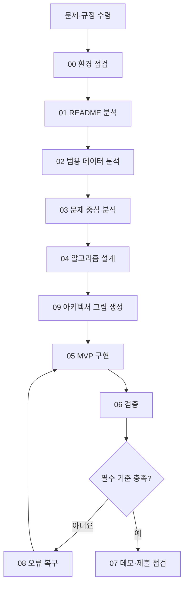
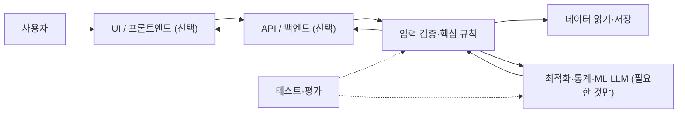
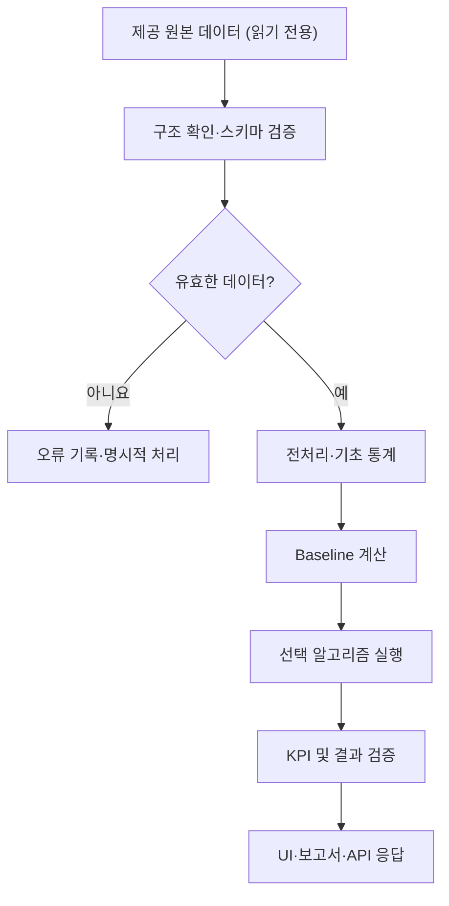

# Codex 해커톤 Skill 아키텍처

> **이 문서는 Skill 패키지 자체의 구조와 범용 예시를 설명합니다. 실제 대회 프로젝트의 구조가 아닙니다.**
> 대회 프로젝트의 실제 아키텍처는 Codex에서 `$architecture-map`을 호출해 생성하세요.

## 1. 해커톤 작업 흐름 (Skill 오케스트레이션)



- 데이터 미제공 과제: 02~03은 수행 불가 범위를 기록한 뒤 축소/생략 가능.
- 오류 복구 스킬: 어떤 단계에서든 필요할 때 사용.
- 작업 순서는 가이드이며 공식 대회 규정 및 실제 문제를 우선합니다.

## 2. 범용 웹 서비스 구성 예시 (To-be, 실제 구현 아님)



**주의:** 프레임워크·DB·AI 모델은 실제 과제에 맞게 **필요할 때만** 도입합니다. 단순 CSV 분석 과제면 UI/API/DB를 생략해도 됩니다.

## 3. 범용 데이터 흐름 예시 (To-be)



## 4. IDE에서 보는 방법

### PowerShell 터미널: 저장소 클론 후

```powershell
git clone https://github.com/YOUR_ID/YOUR_REPO.git
cd YOUR_REPO
python tools/check_skills.py
python tools/show_workflow.py
# Codex CLI를 사용할 수 있다면
codex
```

Codex 대화창에서 다음을 입력합니다.

```text
$architecture-map
README와 현재 코드베이스를 근거로 As-is/To-be/데이터 흐름을 Mermaid로 작성하고,
docs/ARCHITECTURE.md에 저장해 줘. 기존 코드는 수정하지 마.
```

VS Code라면 `docs/ARCHITECTURE.md`를 연 뒤 **Ctrl+Shift+V** 로 미리보기 합니다. (지원 버전/설정에 따라 미리보기 동작은 다를 수 있습니다.) GitHub Markdown 파일에서도 Mermaid 다이어그램을 확인할 수 있습니다.

텍스트 확인만 가능하다면 아래 명령을 사용하세요.

```powershell
Get-Content docs/ARCHITECTURE.md -Encoding UTF8
```

## 5. 실제 아키텍처 품질 체크

1. 그림에 표시된 현재 모듈에 실제 파일 경로가 있는가?
2. 관측된 시스템과 구현 제안을 구분했는가?
3. 데이터 입력/검증/실패 경로가 빠지지 않았는가?
4. P0 요구사항이 처리 모듈과 검증 항목에 연결되는가?
5. 복잡하게 그리기보다 작동 가능한 최소 구조인가?
